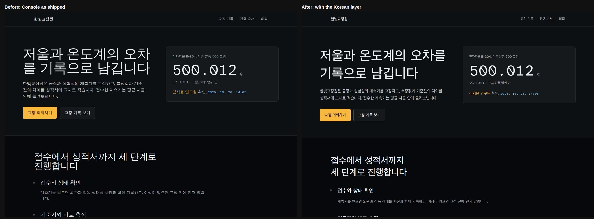
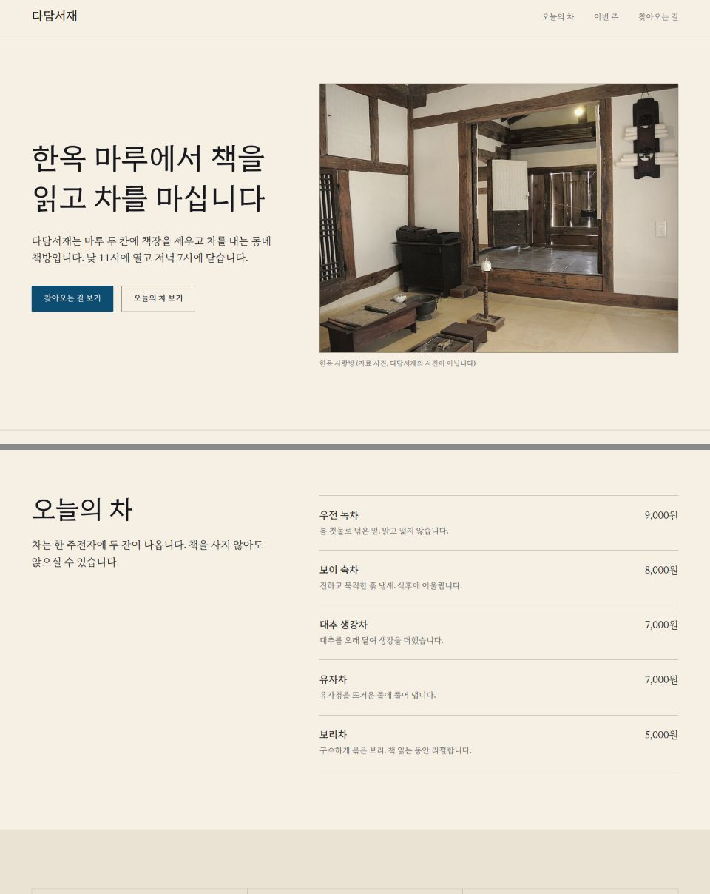
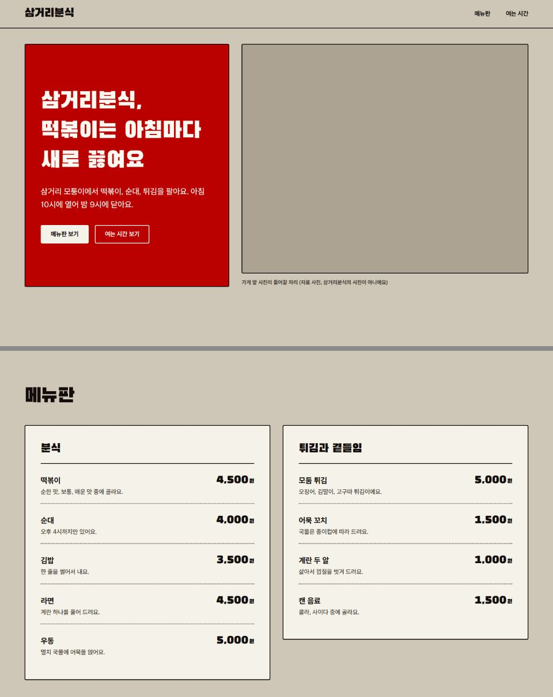
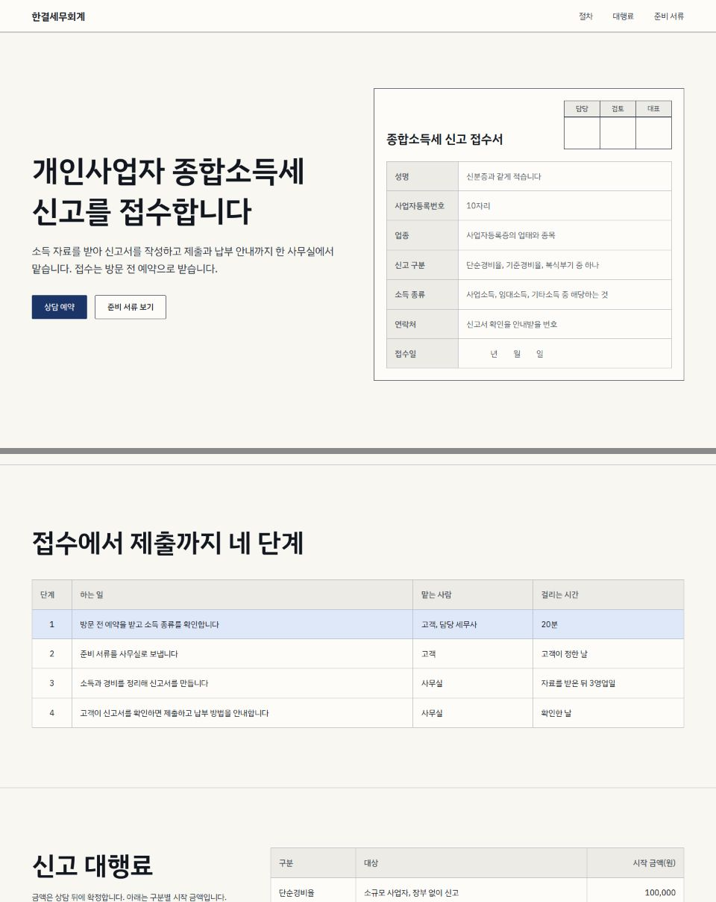

# Hallmark 한국어

[Hallmark](https://github.com/Nutlope/hallmark)(Together AI, MIT)의 한국어 포크. 원본의 AI 티 나는 디자인을 막는 규칙과 린트는 그대로 두고, 한글 페이지에서 깨지는 부분을 메우는 레이어를 얹었다. 스킬 이름과 명령은 원본과 같은 `hallmark`다. 영어 안내는 [README.en.md](README.en.md)에 있다.

## 더한 것

- **한국어 레이어** ([`references/korean.md`](skills/hallmark/references/korean.md)). 한글 글꼴 고르기, 어절 단위 줄바꿈(`keep-all`), 한글 행간과 자간, 문장 부호와 날짜·금액 표기, 한국어 카피 슬롭, 한국 웹의 구성.
- **한글 글꼴 지도** ([`references/themes/hangul.json`](skills/hallmark/references/themes/hangul.json)). 카탈로그 50개 테마마다 라틴 글꼴 뒤에 둘 한글 글꼴과 한국어 키워드(한국 테마 셋 hanji, ganpan, gyeoljae는 각자의 `.md`에 담는다). 한글로 쓴 요청도 테마가 딜된다.
- **한국어 게이트 91~96.** 린트가 `lang="ko"` 선언, 한글 글꼴 이름, `keep-all`, 기울임꼴, 표제 행간 하한, 한국어 슬롭 문구를 잡는다.
- **한국 테마 셋.** 한지, 간판, 결재.

## 전과 후

같은 Console 테마, 같은 한글 문구를 한 번은 테마 그대로, 한 번은 한국어 레이어를 적용해 렌더링했다. 달라진 것은 `lang="ko"`, `keep-all`, 한글 글꼴(Asta Sans), 표제 행간(1.04에서 1.3), 본문 행간(1.55에서 1.7), 표제 자간(-0.03em에서 0)뿐이다. 소스는 [`examples/ko/before-after/`](examples/ko/before-after/).

<p align="center">
  
</p>

왼쪽(전)은 「오차/를」, 「알림/니다」처럼 어절 가운데에서 끊기고, 좁은 행간에 글자가 붙는다. 오른쪽(후)은 어절 단위로 줄이 바뀐다. 전의 한글 글꼴은 테마에 한글 글꼴이 없어서 렌더링한 기계의 시스템 글꼴(이 캡처에서는 WenQuanYi Zen Hei)로 대체된 것이라 기계마다 다르게 보인다.

## 한국 테마

<table>
  <tr>
    <td width="33%"></td>
    <td width="33%"></td>
    <td width="33%"></td>
  </tr>
  <tr>
    <td><b>한지 (Hanji)</b><br/><sub>한옥 책방·찻집, 공방, 전시. 상아색 종이와 가는 괘선, 쪽빛 하나</sub></td>
    <td><b>간판 (Ganpan)</b><br/><sub>동네 가게의 간판과 메뉴판. 굵은 한글 표제와 빨간색 하나</sub></td>
    <td><b>결재 (Gyeoljae)</b><br/><sub>서식과 신청서. 괘선 칸, 틴트 머리칸, 남색 하나</sub></td>
  </tr>
</table>

각 테마의 완성 페이지는 [`examples/ko/`](examples/ko/)에 있다.

## 설치

```
git clone https://github.com/lumianglobal-official/hallmark-ko.git
cd hallmark-ko
node skills/hallmark/scripts/install.mjs
```

Node 18 이상. 설치 스크립트는 모든 테마와 참조 파일을 검증한 뒤 복사한다. 먼저 보고 싶으면 `--dry-run`을 붙인다. 브라우저 검사(`sloplint --render`, 스크린샷)에는 `npm i -g puppeteer-core`와 Chrome이 필요하고, 없으면 정적 검사만 돈다.

Claude Code 플러그인으로도 쓸 수 있다. 마켓플레이스 파일이 상대 경로(`./skills`)를 쓰므로 포크에서 그대로 동작한다.

```
/plugin marketplace add lumianglobal-official/hallmark-ko
/plugin install hallmark@hallmark
```

이 경로는 `/plugin`에서 직접 확인하지 못했고, 마켓플레이스 파일의 구조만 읽어서 확인했다. 플러그인으로 설치하면 명령은 `/hallmark:hallmark`다.

## 사용 예

```
/hallmark 성수동 독립 책방 랜딩 페이지 만들어 줘
/hallmark 망원동 분식집 메뉴판 페이지, 간판 테마로
/hallmark redesign ./src/app
/hallmark audit ./index.html
```

페이지 문구가 한글이면 한국어 레이어가 자동으로 함께 읽힌다. 린트만 돌릴 때는 `node skills/hallmark/scripts/sloplint.mjs <파일-또는-폴더> --render`.

## 원본에서 바꾼 파일

나머지는 모두 새 파일이다. 원본 문장은 번역하거나 재배열하지 않았다.

- `skills/hallmark/SKILL.md`: Load 단계에 한 줄(한글 페이지면 `korean.md`도 읽는다).
- `skills/hallmark/references/fonts.md`: Sources 아래 한 줄.
- `skills/hallmark/references/gates.md`: 한국어 게이트 소절과 판단 항목.
- `skills/hallmark/references/themes/index.json`: 한국 테마 셋 등록.
- `skills/hallmark/scripts/sloplint.mjs`, `sloplint-render.mjs`: `sloplint-ko.mjs` 호출, 게이트 91~96의 등급.
- `skills/hallmark/scripts/theme.mjs`: `deal`이 한국어 키워드도 맞춘다.
- `.github/workflows/verify.yml`: 한국어 린트 테스트 한 단계.
- `README.md`: 한국어로 바꿨고 원본은 `README.en.md`로 남겼다.

## 원본 업데이트 가져오기

```
git remote add upstream https://github.com/Nutlope/hallmark.git
git fetch upstream
git merge upstream/main
```

위 파일들만 원본과 겹치므로 충돌은 그 자리에서 난다. 합친 뒤 `node skills/hallmark/scripts/refcheck.mjs`와 `node --test skills/hallmark/scripts/sloplint-ko.test.mjs`를 돌린다.

## 라이선스

MIT. 원본 [`LICENSE`](LICENSE)(Hallmark contributors)를 바꾸지 않았다. 한글 글꼴은 테마마다 각자의 라이선스를 따르고, `hangul.json`의 CDN 주소로 불러온다.
